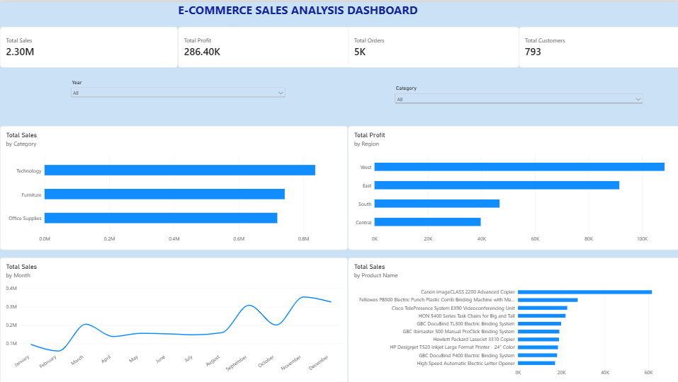

# E-Commerce Sales Analytics

## Project Overview
This project analyzes e-commerce sales data using
Python, SQL, and Power BI
to identify sales trends,
profitability, customer behavior, and business performance.

## Objectives
- Analyze overall sales and profit.
- Identify top-performing product categories.
- Analyze regional profitability.
- Understand monthly sales trends.
- Identify top-selling products.
- Build an interactive Power BI dashboard.

## Tools and Technologies
- Python - Data Cleaning and Analysis
- SQL - Data Querying and Analysis
- Power BI - Data Visualization
- Excel/CSV - Dataset

## Dashboard Preview

## Key Performance Indicators (KPIs)

| Metric | Value |
|--------|-------|
| Total Sales | 2.30M |
| Total Profit | 286.40K |
| Total Orders | 5K (Approx.) |
| Total Customers | 793 |

## Project Structure

Ecommerce_Sales_Analytics/
- 01_Dataset/ - Raw and processed datasets
- 02_Python/ - Python analysis files
- 03_SQL/ - SQL queries
- 04_PowerBI/ - Power BI dashboard and PDF
- 05_Documentation/ - Dashboard screenshot and project report
- README.md - Project overview

## Dashboard Features

- Sales analysis by product category
- Regional profitability analysis
- Monthly sales trend visualization
- Product-wise sales performance
- Interactive Year and Category slicers

## Project Documentation

For detailed information, refer to:
[Project Report](05_Documentation/Project_Report.md)

## Conclusion

This project demonstrates the use of Python, SQL, and Power BI to analyze e-commerce sales data and present meaningful business insights through interactive visualizations.

## Key Insights

- Total Sales: 2.30M
- Total Profit: 286.40K
- Total Orders: Approximately 5K
- The Technology category generated the highest sales.
- Sales performance varied across different regions.
- Monthly sales trends showed fluctuations throughout the year.

## Business Recommendations

- Focus on high-performing product categories to maximize revenue.
- Investigate low-profit regions and optimize business strategies.
- Use monthly sales trends to improve inventory planning.
- Monitor product-level profitability to identify improvement opportunities.
- Develop targeted marketing strategies based on regional performance.

## Project Workflow

1. Data Collection - Imported the Superstore dataset.
2. Data Cleaning - Used Python and Pandas to prepare the dataset.
3. Exploratory Data Analysis - Analyzed sales, profit, and customer data.
4. SQL Analysis - Performed queries to extract business insights.
5. Data Visualization - Created an interactive Power BI dashboard.
6. Documentation - Organized project files and findings on GitHub.

## Skills Demonstrated

- Python Programming
- Pandas
- Data Cleaning
- Exploratory Data Analysis (EDA)
- SQL Queries
- Power BI
- Data Visualization
- Business Analytics
